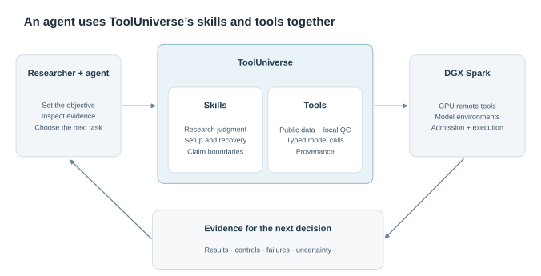
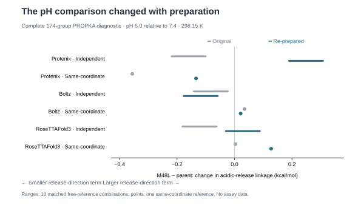

# Using ToolUniverse to help an agent investigate a pH-selective TNF binder

**A practical account of model comparison, GPU remote tools, and the controls that changed our decisions.**

A protein design campaign gets interesting when the models stop agreeing. In our TNF-α exploration, one mutation looked different depending on how we modeled the unbound protein. Repeating the preparation of an unchanged structure could even reverse the apparent benefit. Running more predictions would have produced more numbers; understanding those differences required a more deliberate investigation.

We used an agent with **ToolUniverse’s skills and tools**, with GPU workloads deployed on an NVIDIA DGX Spark, to work through that investigation for Challenge 2 of the Anthropic × Adaptyv competition. We ultimately submitted seven designs. Their binding, mouse cross-reactivity, and pH selectivity remain experimentally unverified. This post explains what we tried, what the results actually supported, and how ToolUniverse helped keep the next task connected to the evidence.

## Start with the right biological question

The [TNF-α challenge](https://proteinbase.com/competitions/anthropic-adaptyv-2026/challenges/tnf-alpha) asks for binding to human TNF-α at pH 7.4, binding to mouse TNF-α, and no detectable human-target binding at pH 6.0. The desired pH behavior is **neutral-pH binding with acidic release**. That direction matters: a strategy carried over from an acidic-binding challenge could optimize the opposite objective.

The agent first separated the problem into questions that different methods could address. Could a candidate fold? Could it form a plausible complex with the soluble TNF trimer? Was that placement compatible with the receptor and explicitly modeled glycans? Did the proposed protonation mechanism favor acidic release? Did the same sequence remain plausible against the mouse construct?

A confident fold answers only the first question. A clash-free pose does not measure affinity. We kept those distinctions throughout the campaign rather than turning every output into a single design score.

## ToolUniverse supplies both the procedures and the callable tools

ToolUniverse contains **skills** that guide an investigation and **tools** that perform specific operations. The agent uses both. A campaign skill can guide model selection, control design and interpretation, while tools retrieve public structures, inspect coordinates, run local analyses or call a model hosted on a GPU server.



This arrangement was useful because the work kept changing shape. A structural discrepancy led to an atom inventory. A pH disagreement led to a free-state comparison. A failed control led back to preparation and assay interpretation. The agent could move between those tasks through a common tool interface, while the skills preserved the scientific context.

On DGX Spark, model environments and weights lived with the GPU workloads. The workloads were exposed through remote-tool interfaces so that the agent could discover their inputs and obtain structured results. ToolUniverse’s setup skills provide a repeatable route for preparing supported model environments, checking dependencies, starting an endpoint, validating a real call, and connecting the endpoint back to ToolUniverse. With the appropriate setup skill and server access, the agent can carry out those steps and load the remote tools into ToolUniverse for subsequent calls. This reduces the model-specific setup it must reconstruct for each campaign.

The [Boltz remote-tool setup skill](https://github.com/mims-harvard/ToolUniverse/blob/main/skills/setup-boltz-remote-tool/SKILL.md) illustrates that route. Custom workloads can use the [host-and-share workflow](https://github.com/mims-harvard/ToolUniverse/blob/main/skills/host-and-share-remote-tool/SKILL.md). Deployment still depends on the model’s license, weights, runtime and available memory; a listed endpoint is not proof that inference has succeeded.

## Explore broadly, then spend compute on a specific uncertainty

We started with de novo backbone generation and sequence design using RFdiffusion3 and ProteinMPNN, then examined complexes using Protenix, Boltz and RoseTTAFold3. These supplied different structural hypotheses. More samples from one family helped assess sampling sensitivity, but did not count as another independent method.

The deeper comparison focused on one parent and a single-substitution alternative, **M48L**. This gave us a controlled question: did changing local packing improve the proposed behavior while retaining structural compatibility?

Before requesting more GPU work, the agent reconciled existing requests and completed outputs. Six parent requests already matched the required protocol and were reused. Only the six missing M48L requests—three complex-prediction families against human and mouse targets—were launched. A filename change was not a reason to rerun an otherwise identical request.

That M48L batch produced 14 structures. Twelve met the existing structural requirements; two were excluded because the required terminal carbonyl was unsupported. We retained the exclusions instead of treating every returned file as a qualified structure. The corresponding parent comparison used 12 previously qualified structures.

For the human complexes, each sequence had a compatible joint glycan-root placement in all six qualified sampled contexts. That is a geometric compatibility result for the specified root hypotheses, not coverage of every glycoform. The hypothetical mouse-root screen had a compatible placement in five of six contexts for each sequence. Its failing context also failed a receptor-only check with the binder removed, so we could not attribute that failure specifically to M48L.

ToolUniverse’s practical contribution here was continuity: sequence identity, model inputs, structural requirements and earlier exclusions stayed attached to the next analysis. A new prediction did not erase the reasons an earlier result was unusable.

## Ask what the pH calculation is comparing

Adding histidines does not specify a pH switch. Their effect depends on the surrounding environment and on what changes between bound and unbound states. Other receptor groups and real protein termini can reinforce or oppose the proposed mechanism.

We therefore audited the complete modeled protein ionization inventory: **174 groups**, including actual termini, for the selected protein-only systems. We evaluated two free-state conventions separately:

- **Independent free structures:** separately modeled free binder and apo receptor references.
- **Same-coordinate components:** binder and receptor extracted from the complex coordinates, then evaluated separately.

Both references still titrate. “Same-coordinate” does not mean frozen protonation.

The calculations produced a conditional protonation-linked energy difference between pH 6.0 and 7.4. Positive values indicate an acidic-release contribution under that model. They do not establish absolute affinity or whether binding would fall below an assay’s detection limit.

The mutation comparison immediately exposed sensitivity. In the original Protenix context, M48L’s change relative to the parent ranged from **−0.219 to −0.100 kcal/mol** with independent free references. In the Boltz context, the corresponding range was **−0.142 to −0.023 kcal/mol**, while its same-coordinate comparison was **+0.035 kcal/mol**. The reference choice could change the sign.

Partial neural pKa analyses and a selected-histidine learned-energy diagnostic offered additional views, but had different coverage and assumptions. We compared shared sites where appropriate and kept learned model units separate. Two related neural weight sets remained one family. Agreement on a restricted diagnostic would not establish a complete pH mechanism.

## The most informative next step was a preparation control

A local interaction near the proposed switching environment appeared weaker in some M48L structures. It was tempting to explain that observation as a mutation effect. Before accepting that explanation, we repeated hydrogenation and restrained physical preparation for the **unchanged parent and M48L predicted starting poses**.

We ran a bounded pilot of **15 prepared contexts**: three parent starting poses, three M48L starting poses, and nine M48L sidechain starts across the three structural families. All 15 passed the existing physical requirements and retained a compatible human glycan-root placement. Passing those requirements still did not establish an equilibrium ensemble.

The control changed the interpretation. Re-preparing an unchanged M48L predicted pose restored the histidine–receptor contact whose absence had motivated concern. Contact loss was preparation-sensitive; the original observation could not establish that the mutation destroyed that interaction.

The pH comparison changed too. After matched starting-pose re-preparation, the Protenix independent-reference difference moved to **+0.190 to +0.308 kcal/mol**, while its same-coordinate result remained negative at **−0.134 kcal/mol**.



*The figure compares M48L minus parent for the pH 6.0 versus 7.4 linkage term at 298.15 K, using the same bound sample in each before/after comparison. It uses sample 0 for RoseTTAFold3 rather than mixing all original samples with one re-prepared sample. Each line spans ten correlated combinations of five free-binder samples and two apo-receptor references; each point represents one same-coordinate reference. These are sensitivity ranges, not confidence intervals or biological replicates. [All 33 paired comparisons](assets/tnf-design/paired_deltas.csv) and [plotted ranges](assets/tnf-design/reference_sensitivity.csv) are available as aggregate source data.*

None of the nine sidechain starts produced a uniformly favorable change across the evaluated methods and references. Some starts also relaxed toward similar minima. We did not treat those starts as nine independent thermodynamic states or select the most favorable local score as a new design.

## Controls tell an agent when a score is not ready to decide

Known binders were an essential check on the complex-prediction pipeline; the submitted lineage itself was generated de novo. Two additional public-control predictions passed physical preparation but recovered **none of the native interface contacts** under the existing evaluation. Physical plausibility alone had not calibrated blind pose recovery. We preserved that failure and did not use the pipeline’s score as a validated absolute binding veto.

We also checked what published pH controls actually measured, including the acid-wash experiments in [the anti-TNF patent’s Examples 3 and 8](https://patents.google.com/patent/US20250388665A1/en). Acid-wash retention, dissociation behavior, EC50 and equilibrium KD are different observables. A retention experiment can inform a mechanistic hypothesis without supplying the paired equilibrium measurements needed to calibrate our complete pH calculation. Matching the assay endpoint mattered as much as matching the target name.

An independent free-fold check provided another useful boundary: M48L passed the original core gate, but its matched parent failed. That was a mutant-only result, not a successful paired validation. We reused the existing outputs and kept the failed comparison visible.

These findings narrowed what we could conclude. They also made the next useful work clearer: improve control recovery and reference robustness, then obtain matched binding measurements, rather than expand sequences around an uncalibrated score.

## A submission with a traceable rationale

We submitted **seven designs** from one backbone lineage, each 99 amino acids long. They represent related sequence and mechanistic alternatives, not seven independent scaffolds. The deeper M48L investigation did not justify replacing the reviewed package with that exploratory variant.

All seven passed the portal’s official novelty checks. We verified submission success separately: the saved collection contained seven entries, and its downloaded names, exact sequences and order matched the reviewed file. The persisted methodology matched as well. The [submission collection](https://proteinbase.com/collections/anthropic-adaptyv-protein-design-competition-submission-1-X8MAX9zP0b) records that package.

Novelty and submission success do not establish binding. Experimental selection and measurements were still pending when this post was written. The useful outcome of this exploration was a set of testable designs with a clearer account of their assumptions, controls and unresolved evidence.

## Try ToolUniverse with your own agent

The quickest starting point is the [ToolUniverse setup guide](https://aiscientist.tools/setup.md). Paste this into your agent:

```text
Read https://aiscientist.tools/setup.md (if 403, use https://raw.githubusercontent.com/mims-harvard/ToolUniverse/main/skills/setup-tooluniverse/SKILL.md) and setup tooluniverse for me.
```

For a command-line trial:

```bash
uvx --from tooluniverse tu status
uvx --from tooluniverse tu find 'protein structure analysis'
```

The guide covers agent integration, the CLI, the Python SDK and skill installation. Browse the [research skills](https://aiscientist.tools/search?view=skills), including the [protein-design campaign skill](https://github.com/mims-harvard/ToolUniverse/tree/main/skills/tooluniverse-protein-design-campaign). For a GPU server, point the agent to the relevant model setup skill and have it verify setup, discovery and a small inference before launching a campaign.

A useful first research prompt is:

```text
Use ToolUniverse's protein-design campaign skill to investigate this target.
Read the challenge and existing results first. Separate folding, complex pose,
glycan compatibility, cross-species evidence and pH hypotheses. Reuse completed
matching requests, compare parent and variant under matched conditions, and
choose the next computation that resolves a specific uncertainty. Keep
experimental binding and pH selectivity unverified until measured.
```

That is the pattern we would reuse: give the agent tools it can execute, skills that preserve the scientific question, and enough evidence to decide when another prediction will actually help.
